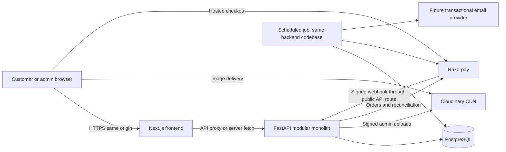

# Home Decor: technical architecture

Status: phase 01 architectural baseline, prepared 20 September 2026. Phases 03–06 now implement design tokens, database schema, backend foundation and authentication; see [database design](database.md), [authentication](authentication.md) and [verification](verification.md) for the current implementation. Production-only behavior below remains a target. Phase 04 supersedes integer-paise database storage with PostgreSQL NUMERIC(12,2) and Python Decimal, converting to paise only at the provider boundary. Location-aware inventory remains a future checkout migration; the initial schema is single-location.

## Scope, assumptions and decisions

Single-vendor home-decor ecommerce for Bangalore initially and other serviceable Indian locations. One developer owns a customer website and an admin area. The locked stack is Next.js, TypeScript, Tailwind CSS, FastAPI, Python, PostgreSQL, SQLAlchemy, Alembic, Cloudinary, Razorpay and Git/GitHub. All are retained. No microservices, Kubernetes, Kafka, Redis or Elasticsearch are required.

Planning assumptions, to validate before the dependent phase:

| Assumption | Consequence / validation needed |
| --- | --- |
| One Bangalore dispatch location; physical goods with SKU variants | Start with one inventory location, but associate stock with location IDs |
| INR only, prices represented in paise | No floating-point currency; decide tax-inclusive presentation and invoice rules before checkout |
| Initial catalog below 10,000 SKUs and modest traffic | PostgreSQL search and one API instance; benchmark before launch rather than treating this as proven capacity |
| Guest checkout plus optional email/password customer accounts | Guest order access needs separate expiring tokens; no account existence disclosure |
| Prepaid Razorpay checkout first | COD, subscriptions, international payments, multi-vendor settlement and marketplace features excluded |
| One-day means delivery by the next eligible day, before a configured cutoff | Business must approve exact wording, holiday calendar and courier commitment; do not promise universal 24-hour delivery |
| English and India addresses initially | Keep currency/timezone explicit; localization is deferred |
| Small admin team | One admin permission set initially; require MFA and audit privileged actions before production |
| Provider, budget, domain and courier not selected | Architecture is provider-neutral; obtain current quotes and Bangalore/India latency measurements before choosing hosting |

Email delivery is a demonstrated requirement for verification, password recovery and order confirmations. Choose a transactional email provider in the notifications phase; no email SDK or service is added now. GST, invoicing, privacy, retention, cancellation and returns policies require business/legal approval before launch. This design does not determine applicable legal obligations.

## 1. System architecture

A monorepo contains two deployable applications and one database. FastAPI is a modular monolith: it exclusively owns business rules, authentication, prices, stock, payments and database writes. Next.js owns rendering and interaction, not a second business backend.

Production uses one public origin, for example `https://shop.example.com`, with `/api/v1/*` routed to FastAPI. The scaffold uses Next.js rewrites; production can keep these or have the hosting ingress route `/api` directly. Preserve Set-Cookie, raw webhook bytes, request IDs and request-size limits end to end. FastAPI must remain reachable by the proxy; restrict direct public access where the platform permits. Next.js server components can call the private backend URL for public data. Explicitly forward only the required cookie for personalized server fetches; do not forward arbitrary browser headers.

The only extra execution unit planned is a scheduled command from the same backend package, once durable payment reconciliation/reservation expiry/notification retries exist. This is not a separate service boundary. PostgreSQL stores pending jobs and an outbox; a managed scheduler invokes the command. Essential work must not depend on an in-process background task surviving a restart.

## 2. Frontend architecture

Use the Next.js App Router, TypeScript strict mode and Tailwind CSS. Prefer server components for public catalog content and metadata; use small client components for variant selectors, cart interactions and payment checkout. Use native fetch; do not add a global state library, component kit or query library until a concrete feature benefits.

Planned routes: `/`, `/categories/[slug]`, `/products/[slug]`, `/search`, `/cart`, `/wishlist`, `/checkout`, `/account/orders` and `/admin`. Route groups may organize storefront and admin without changing URLs. Feature-specific UI stays near routes; extract shared components only when reused. Phase 03 defines tokens, typography, spacing, form states and accessible interaction patterns.

FastAPI OpenAPI is the API contract. Generate TypeScript types when business endpoints exist, and fail CI on contract drift then. Use `/api/v1` for public API versioning. Treat loading, empty, validation, forbidden and failure states as explicit UI states. Backend errors will expose a stable code, safe message, field errors where applicable, and request ID.

Public catalog responses may use explicit short revalidation (initial proposal: 60 seconds) plus invalidation after admin edits. Do not assume framework caching defaults. Checkout, account, admin, stock quotes and all cookie-dependent responses use `no-store` and are excluded from shared caches. Product pages may show cached prices, but cart and checkout always obtain current authoritative quotes. No sensitive tokens in localStorage. Anonymous cart persistence can contain SKU IDs and quantities, never authoritative prices.

Mobile-first, semantic HTML, visible focus, keyboard navigation, labelled forms, useful alt text and adequate contrast are acceptance criteria. Use system fonts initially to avoid remote build-time font dependencies. The setup page is deliberately not the homepage design.

## 3. Backend architecture

FastAPI modules will be organized by domain: identity, catalog, inventory, carts, checkout, payments, orders, delivery, media, notifications and admin. Each contains routers and request/response schemas; services own transaction and business rules; SQLAlchemy models own persistence. Avoid generic repository abstractions unless they remove demonstrated duplication. Admin endpoints reuse domain services with privileged authorization.

Use SQLAlchemy 2 synchronous sessions with psycopg 3. Database-backed handlers are synchronous `def` functions so blocking work runs off the async event loop. One session per request/job, never shared across threads. Services explicitly commit or roll back a unit of work. No database calls at import or liveness time. Alembic alone changes schemas; never call `create_all()` at application startup.

Apply pagination and bounded filters to list endpoints. Validate inputs with Pydantic, keep response models separate from persistence models, and never serialize credential columns. Use UTC timestamps in storage and Asia/Kolkata for delivery calendars and display.

External provider calls have bounded timeouts and retries only where safe. Do not hold stock locks across a payment network call: persist an attempt, call the provider, then attach its result in a new transaction. Ambiguous provider failures are reconciled before a fresh attempt is created. Logs contain request IDs, event IDs and durations, not passwords, cookies, complete addresses or raw payment payloads.

## 4. Database architecture

PostgreSQL is the source of truth. Phase 04 creates the actual schema and migrations; the current metadata is intentionally empty.

| Domain | Planned tables and relationships |
| --- | --- |
| Identity | users, password_reset_tokens, email_verification_tokens, sessions; user has many addresses and sessions |
| Catalog | products, product_variants, categories, product_categories, product_media; product has variants and media |
| Inventory | inventory_locations, stock_levels, stock_reservations, inventory_movements; stock keyed by location and variant |
| Shopping | carts, cart_items, wishlists, wishlist_items; unique cart/variant or user/variant pairs |
| Commerce | orders, order_items, order_address_snapshots, checkout_attempts; order items snapshot SKU, name, unit price and tax |
| Payments | payment_attempts, payment_events, refunds; order has many attempts but fulfillment runs once |
| Delivery | serviceable_postcodes, delivery_rules, delivery_holidays, shipments; rules have service type, cutoff, fee and lead time |
| Operations | outbox_events, job_attempts, admin_audit_events; persist retry status and next attempt time |

Use UUID primary keys and separate human-readable unique order numbers. Amounts use integer paise (BIGINT), currency codes are explicit, quantities are nonnegative integers. Add foreign keys, not-null constraints, positive quantity checks, unique SKU/slug/provider event/payment IDs, and indexes based on actual access patterns. Product/category slug history supports redirects. Use archive flags for products; do not cascade-delete historical order or financial records.

Inventory invariant: available = on_hand - reserved, with `0 <= reserved <= on_hand`. At checkout atomically lock affected stock rows in a stable variant order, verify availability, create a short-lived reservation and increment reserved. On captured payment, decrement on_hand and reserved exactly once in the same transaction that advances the order. On expiry/cancellation release reserved exactly once. Expiry and webhook processing take the same reservation/order locks. If payment arrives after expiry, reacquire stock transactionally; if unavailable, flag an exception and start the refund process, without overselling.

Orders snapshot prices, discounts, fees, tax treatment, delivery promise and shipping address so later catalog changes cannot alter history. Each checkout idempotency key is unique within its owner scope and bound to a request fingerprint. Reusing it with a different payload returns a conflict. Use unique constraints and compare-and-set transitions in addition to application checks.

Search begins with normalized indexed filters and PostgreSQL full-text search using a GIN index; add pg_trgm only if measured typo-tolerance needs justify it. Avoid offset pagination for deep admin/order history. Database connection limits must cover all processes: current pool upper bound is 10 connections per API process, plus migrations/jobs; reduce it for small managed plans.

Migrations are reviewed SQL changes with expand/backfill/contract sequencing for destructive changes. Take a recoverable backup before risky changes. Managed daily backups plus point-in-time recovery are a launch requirement; proposed business targets are RPO <= 15 minutes and RTO <= 4 hours, pending provider cost approval and a restore drill.

## 5. Authentication architecture

FastAPI owns authentication using email/password and opaque server-side sessions stored in PostgreSQL. Use Argon2id password hashing through a maintained library, benchmark its parameters, normalize email consistently and enforce uniqueness. Registration verification and password recovery use short-lived, single-use random tokens stored only as hashes.

Generate high-entropy session tokens, store only their hashes, rotate after login/privilege change and revoke on logout/reset. Proposed expiry policy: customers 7-day absolute lifetime with a 24-hour idle timeout; admins 8-hour absolute with a 30-minute idle timeout, with explicit server enforcement. Store tokens in a host-only `HttpOnly; Secure; SameSite=Lax; Path=/` cookie, using a `__Host-` name in production. Local HTTP development uses a separate cookie configuration. Never place tokens in URLs or browser storage.

All state-changing browser requests, including login, require verified same-origin Origin/Referer and a session-bound CSRF token; anonymous login/registration flows obtain a pre-authentication CSRF token. Safe methods must not mutate state. SameSite is additional protection, not the complete CSRF control. Razorpay webhooks are exempt from browser CSRF only because they require provider signature verification. No permissive CORS: same-origin browser traffic makes it unnecessary.

FastAPI enforces customer ownership and admin privileges on every protected endpoint. Frontend route guards only improve UX. Admin creation is an explicit offline management command, never public registration; require MFA, secure recovery and step-up authentication for refunds/role changes before launch. Rate-limit login/reset at ingress with database-backed account throttling so multiple workers cannot bypass limits. Guest orders use expiring random access tokens with hashed storage and restricted scope; order numbers alone never authorize access.

## 6. Payment architecture

Use Razorpay hosted Standard Checkout with backend-created Razorpay Orders. Only the public key ID reaches the browser; key secret and webhook secret remain backend secrets. No PAN, CVV or card data enters this database or logs.

1. Backend recomputes cart prices, tax, fees and serviceability, reserves stock, and saves a pending order plus idempotent checkout attempt.
2. Backend creates the provider order for that exact INR amount, stores its ID and returns checkout data. Never trust browser amounts. Provider-create retries must follow verified provider semantics; a timeout is an unknown outcome, not proof of failure.
3. Browser opens Checkout. A success callback is not permission to fulfill. Backend verifies the callback HMAC against the stored provider order ID and confirms order, amount, currency and captured status through authenticated provider data.
4. The webhook endpoint verifies HMAC against the original raw request bytes before parsing, limits body size, deduplicates by provider event ID, and durably stores the event before acknowledging. A database failure returns a retryable error. Duplicate events are acknowledged safely.
5. One transactional state-transition service handles callback, webhook and reconciliation results. Payment capture marks an order paid once, consumes its reservation and writes notification/fulfillment outbox records atomically. Events may arrive late or out of order: a late failure cannot regress a captured payment.
6. A scheduled reconciliation command checks unresolved attempts and retryable events, expires reservations and surfaces aged failures to an admin. Payment captured with local write failure converges via webhook/reconciliation. Additional successful payments for an already-paid order require explicit duplicate-payment refund handling.

Model payment state separately from order/fulfillment state. Payment examples: created, authorized, captured, failed, partially_refunded, refunded. Order examples: awaiting_payment, paid, processing, shipped, delivered, cancelled. Authorized is not captured. Refunds have their own pending/processed/failed transitions, provider identifiers, idempotency and audit trail. Refund initiation is not proof funds were returned. Cancellation rules depend on fulfillment state; inventory release and physical restocking are distinct events.

Use Razorpay test mode in staging, separate live keys/webhook secrets, and test duplicate callbacks, delayed capture, lost responses, invalid signatures, refunds and reconciliation before enabling live checkout. Capture settings and settlement expectations must be verified in the merchant account.

## 7. Media architecture

Cloudinary stores product imagery; PostgreSQL stores asset/public ID, version, dimensions, format, bytes, ordering and alt text. Public product media is cacheable; do not put invoices or private customer information into publicly delivered assets.

Initially proxy admin uploads through FastAPI with strict request size, MIME/decoded-image validation, pixel limits and an allowed raster format list. The backend performs authenticated signed uploads; no unsigned public preset and no secret in frontend code. If upload bandwidth later warrants direct browser uploads, issue short-lived admin-authorized restricted signatures and verify uploaded metadata before attaching assets.

Use a bounded set of responsive Cloudinary transformation presets, automatic format/quality and fixed dimensions to reduce layout shift and transformation costs. Configure Next.js image remote patterns for the exact Cloudinary account/path when images are introduced. Choose a Cloudinary loader or direct responsive URLs so Next.js does not unnecessarily re-optimize already transformed assets. Replace images using versioned URLs; delete orphaned assets only after a grace period and reference checks. Treat provider quotas and accidental deletion as operational risks.

## 8. Delivery and serviceability architecture

Never infer a next-day promise from a city text field. Validate Indian six-digit postcodes server-side against an explicit serviceability table. Each active rule identifies dispatch location, shipping fee, supported service, cutoff in Asia/Kolkata, eligible dispatch/delivery days, lead time, handling constraints and capacity. Unsupported postcodes block checkout, while a courier outage or unknown status gives an unavailable quote rather than a fabricated date.

Next-day Bangalore eligibility requires a configured postcode, stock at the Bangalore location, an order before cutoff, available dispatch/courier capacity and an eligible next delivery day. Rules for bulky/fragile items and holidays can override the default. Other approved postcodes receive an estimated standard range. Business must decide whether capacity is reserved with stock or conservatively capped; implement atomic capacity reservation before offering guaranteed slots.

Show indicative availability on the product page; recalculate at checkout and snapshot the final range, fee and rule version onto the order. If eligibility changes, obtain acceptance of the revised quote before payment. A first version may use admin-maintained postcode imports and manual shipment/tracking entry. Do not add a courier integration before one is selected. Include exception handling for failed delivery, returns and damaged items in the operations workflow.

## 9. SEO architecture

Render product/category content on the server with stable slug URLs and canonical tags. Use the Next.js Metadata API for unique titles/descriptions, Open Graph and social imagery; produce segmented sitemaps when necessary and explicit robots rules. Add Product/Offer and BreadcrumbList JSON-LD only for truthful visible data; escape serialized content safely. Never invent ratings or availability.

Public categories and products are indexable at launch. Search results, arbitrary filter combinations, cart, checkout, account and admin are noindex; prevent unbounded crawl spaces. Retain useful out-of-stock product pages with accurate availability. Redirect changed slugs permanently; return 404/410 for removed content where no equivalent exists. Do not redirect every removed product to the homepage.

Staging needs authentication/access restriction as well as noindex. The scaffold globally disables indexing, which must be replaced with route/environment-aware policies before launch. Robots directives are not access controls. Verify rendered HTML, canonicals, structured data, sitemap URLs and status codes after deployment. Track mobile Core Web Vitals; target p75 LCP <= 2.5 s, INP <= 200 ms and CLS <= 0.1 as project goals.

## 10. Security architecture

Trust boundaries are browser-to-app, proxy-to-API, API-to-database and provider callbacks. Recompute money and permissions server-side. Use parameterized SQLAlchemy expressions, allowlisted sort/filter columns, strict field schemas and limits against oversized payloads. Render text safely; prohibit arbitrary HTML initially. If rich content is needed later, sanitize it using an audited policy.

Production requires TLS, managed secrets, a least-privilege database runtime role separate from migration privileges, encrypted backups, a private database network and dependency patching. Disable public interactive API docs by default, but never regard obscurity as authorization. Adopt CSP with exact Razorpay/Cloudinary origins tested in report-only mode first, HSTS after HTTPS is validated, frame-ancestors, nosniff and a restrictive referrer policy. Verify provider checkout works under the final CSP.

Audit admin changes to stock, prices, fulfillment and refunds with actor, timestamp, target and redacted before/after values. Minimize address/phone access and define retention and deletion policies with business approval. Redact secrets and PII in logs, error tracking and analytics. Secret scanning and lockfile review run before publishing changes. Shared rate limiting must be provided by the hosting ingress or transactional PostgreSQL logic; per-process memory counters alone are insufficient.

Risks include credential stuffing, account/order ID enumeration, CSRF, stored XSS through catalog content, inventory races, forged payment callbacks, duplicate capture processing, webhook replay, expensive image transformations and leaked backups. Each has controls above and corresponding tests below. No claim of production security is made for this phase-02 scaffold.

## 11. Testing strategy

Current setup checks: frontend lint/typecheck/build, API tests for dependency-free liveness and safe readiness responses, a real HTTP frontend/API proxy check, and PostgreSQL readiness/migrations when PostgreSQL is available.

Future unit tests cover pure money calculations, delivery cutoff/holiday rules and allowed state transitions. Integration tests use real PostgreSQL (not SQLite) for transactions, constraints, migrations, unique event handling and concurrent stock reservations. Contract tests verify the OpenAPI schema against generated client types. Add browser end-to-end tests when flows exist: guest/account checkout, failed/retried payment, expired stock reservation, ownership checks and admin permissions. Use Razorpay test mode and signed webhook fixtures, including exact raw-byte signature tests.

Security regression tests cover CSRF, cookie flags, reset-token replay, non-admin access, cross-user order reads, upload validation and rate limiting. Accessibility tests combine automated checks and manual keyboard/screen-reader review. Test backup restoration and deployment rollback before launch. Load tests use realistic browsing/checkout mixes and record p95 API latency, database connections/locks and error rate; provisional goal is p95 < 500 ms for ordinary non-provider API reads under the agreed initial load.

CI gates pull requests on lint, typecheck, production build, backend tests and migration readiness against a disposable PostgreSQL service. Add external-provider and browser suites when those integrations exist, avoiding flaky live dependencies in normal PR checks.

## 12. Deployment and operations strategy

Recommended shape: managed Next.js Node hosting, one managed FastAPI process/container, and managed PostgreSQL in nearby regions with private access where supported. Select exact vendor and India region after budget, bandwidth, backup, cron, proxy and operational requirements are checked. Containerization is optional packaging, not a requirement for Kubernetes. Local Compose runs PostgreSQL only and is not a production deployment configuration.

Use development, staging and production with separate databases, Cloudinary environments/folders and Razorpay keys. GitHub Actions provides repeatable checks; protected main and review gates can be enabled after a remote exists. Pin resolved dependencies, deploy a specific Git revision, and keep the previous application revision available.

Release order: backup/restore readiness check, one controlled Alembic migration job, backend rollout with readiness check, frontend rollout, and smoke tests. Never have every replica race to migrate. Prefer backward-compatible changes; roll back applications while retaining compatible expanded schemas. Destructive schema rollback may need forward repair or a restore and must not be an automatic response.

Liveness `/api/v1/health` checks the process. Readiness `/api/v1/ready` checks database connectivity and returns 503 safely on failure. Before production, extend readiness/release checks to confirm the expected migration revision. Record structured logs, 5xx/error rate, p95 latency, database saturation, outbox age, failed reconciliation, failed jobs, stock exceptions and payment-to-order mismatches. Alert on actionable failures; no sensitive payloads in monitoring. Hosting restart policies and scheduled-job heartbeats are required.

Proposed launch gates: approved delivery/returns/tax policies, live merchant onboarding, tested payment/refund path, admin MFA, real database concurrency tests, secret review, restore drill, monitoring contacts, indexing policy, mobile accessibility and a final test purchase. The scaffold is not a launch-ready store.

## 13. Future scalability strategy

Scale from evidence. First optimize queries, indexes, response sizes, image delivery and public-page caching. Use measured query plans and connection budgets before raising worker counts. Next scale application instances horizontally; PostgreSQL sessions, locks, idempotency records and durable jobs already support this, while shared rate limiting and cache invalidation must be verified.

| Trigger | Smallest next step |
| --- | --- |
| Slow catalog/search after query/index tuning | Improve PostgreSQL indexes and ranking; consider a search service only if relevance/latency requirements cannot be met |
| API CPU saturation at measured peak | Add workers/instances within the DB connection budget |
| PostgreSQL connections near limit | Reduce per-process pools; assess provider connection pooling before adding infrastructure |
| Durable job backlog breaches payment/notification SLO | Run more workers from the same codebase using row locks and leases; consider a queue only if measured throughput requires it |
| Public read traffic dominates | Expand CDN/cache strategy with explicit invalidation; evaluate replicas only when stale reads are acceptable |
| New warehouses | Activate location-aware inventory, fulfillment allocation and per-location delivery rules |
| Solo maintenance load becomes unsustainable | Reduce feature scope or add ownership before splitting into services |

Redis, Kafka, Kubernetes and microservices have no justified launch requirement. Cloudinary and Razorpay are isolated behind backend integration modules to contain provider-specific behavior, without prematurely building a universal provider abstraction.

## Implementation boundary and risks

Phase 02 implements tooling and connectivity only. Authentication, business schemas, catalog, checkout, payments, delivery, uploads, notifications, production headers and deployment infrastructure remain planned. The development health page is not proof those features exist.

The largest risks are a delivery promise unsupported by operations, ambiguous payment outcomes, overselling during concurrency, lack of durable background reconciliation, untested recovery and a solo developer's maintenance capacity. Resolve policy questions before checkout work, and treat payment reconciliation, stock invariants, admin authorization and restore testing as launch blockers. OneDrive-synced node_modules/virtualenv directories may cause locking and slow installs on Windows; if this occurs, move the repository to a local nonsynced development folder.

## Primary references

Consulted for framework and provider behavior; verify again during their implementation phases:

- [Next.js installation and supported setup](https://nextjs.org/docs/app/getting-started/installation)
- [Tailwind CSS with Next.js](https://tailwindcss.com/docs/installation/framework-guides/nextjs)
- [FastAPI deployment concepts](https://fastapi.tiangolo.com/deployment/concepts/)
- [SQLAlchemy session and transaction lifecycle](https://docs.sqlalchemy.org/en/20/orm/session_basics.html)
- [Razorpay server integration and signature verification](https://razorpay.com/docs/payments/server-integration/nodejs/integration-steps/): provider protocol reference; implementation will use Python, not the Node SDK.
- [Razorpay webhook events](https://razorpay.com/docs/webhooks/all/)
- [Cloudinary authenticated uploads](https://cloudinary.com/documentation/upload_images)
- [OWASP sessions](https://cheatsheetseries.owasp.org/cheatsheets/Session_Management_Cheat_Sheet.html), [CSRF](https://cheatsheetseries.owasp.org/cheatsheets/Cross-Site_Request_Forgery_Prevention_Cheat_Sheet.html), and [password storage](https://cheatsheetseries.owasp.org/cheatsheets/Password_Storage_Cheat_Sheet.html)
