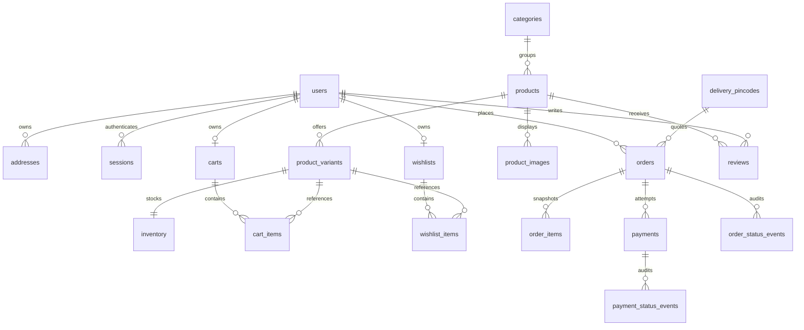

# Database design — phases 04–06

This design supersedes the phase-01 integer-paise storage proposal: money is `NUMERIC(12,2)` in INR and Python `Decimal`. Provider integrations must convert exact Decimal rupees to integer paise at their boundary; never use float. PostgreSQL enforces nonnegative values. Currency is currently restricted to INR.

## Relationships before models

Users have many addresses and orders, one active cart and one wishlist. A cart may instead belong to a random guest token (stored hashed); exactly one ownership form is allowed. A product belongs to one category initially, and has many images and SKU variants. Each variant has one inventory row for the initial single warehouse. Cart and wishlist items refer to variants, with unique owner/variant pairs. Each order holds immutable address and item snapshots, while optional foreign keys preserve traceability to users/variants. Products and categories can be archived; order and payment records are retained, not soft-deleted.

Orders have many payment attempts and order status events; payments have many payment status events. Each event records the old/new status, timestamp, actor and reason. PostgreSQL triggers enforce allowed transitions and automatically record state changes, including the initial state; history rejects update/delete. External payment-event IDs are unique on history rows when supplied. Provider signature verification and payment processing remain later phases.

Users also own hashed opaque sessions needed for authentication. Database-backed authentication rate buckets provide multi-process login/registration throttling. These supporting tables are necessary for the requested security/audit behavior, not generic infrastructure. Reviews are unique per customer/product and may be moderated; a review is not advertised as a verified purchase until order verification is implemented.

The diagram's postcode relationship is logical: orders snapshot their delivery postcode and quote rather than depend on a mutable delivery rule. Inventory is single-location by explicit initial assumption; add locations/reservations with checkout, before any stock-selling endpoint exists. Database checks enforce `0 <= reserved <= on_hand`. Future checkout must lock stock rows and atomically reserve/decrement inventory; models alone do not make checkout concurrency safe.

UUID keys, timezone-aware timestamps, foreign keys and access-path indexes are used throughout. Normalized lowercase emails and unique slugs/SKUs are enforced. Numeric totals are checked, and order items retain exact unit prices/quantities. Cross-row order-total reconciliation belongs to the future checkout transaction. Images are HTTPS references plus Cloudinary identifiers, never binary database content.

## States

Order: awaiting_payment → paid/cancelled; paid → processing/cancelled; processing → shipped/cancelled; shipped → delivered; delivered/cancelled are terminal. Returns/refunds have separate payment state; additional fulfillment states require a reviewed migration.

Payment: created → authorized/captured/failed; authorized → captured/failed; captured → partially_refunded/refunded; partially_refunded → refunded. Failed/refunded are terminal. Each provider retry creates a distinct attempt. Captured state is permitted in the schema but only a verified payment service may invoke it when implemented.

## Seeds and migrations

`python -m app.seed` idempotently inserts only approved reference categories. No users, passwords, paid orders, fake reviews or serviceability promises are seeded. Admins are created explicitly with `python -m app.cli create-admin` using hidden password input. Test fixtures use a disposable PostgreSQL database and transactions that roll back per test.

Initial migration `0001_initial` freezes schema operations and PostgreSQL audit triggers. Run `alembic upgrade head` then `alembic check`. Test upgrade, downgrade and re-upgrade on a disposable database only. Never use `create_all()` in application startup or import live model metadata into a historical migration. Existing business data requires a backup before migration changes.
